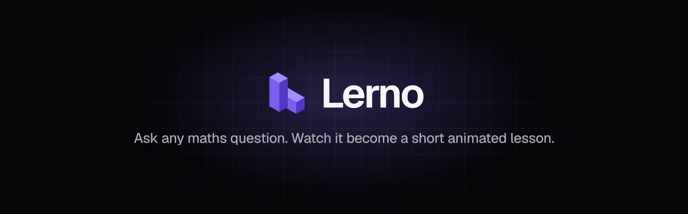
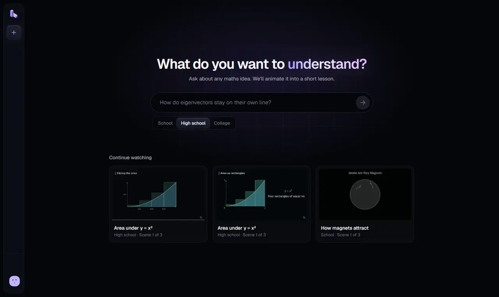
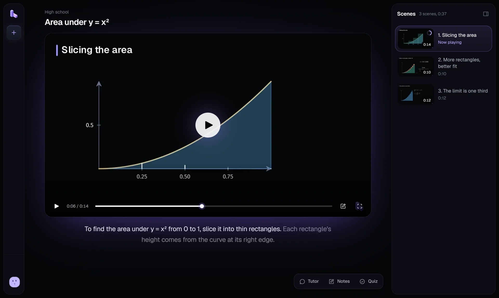
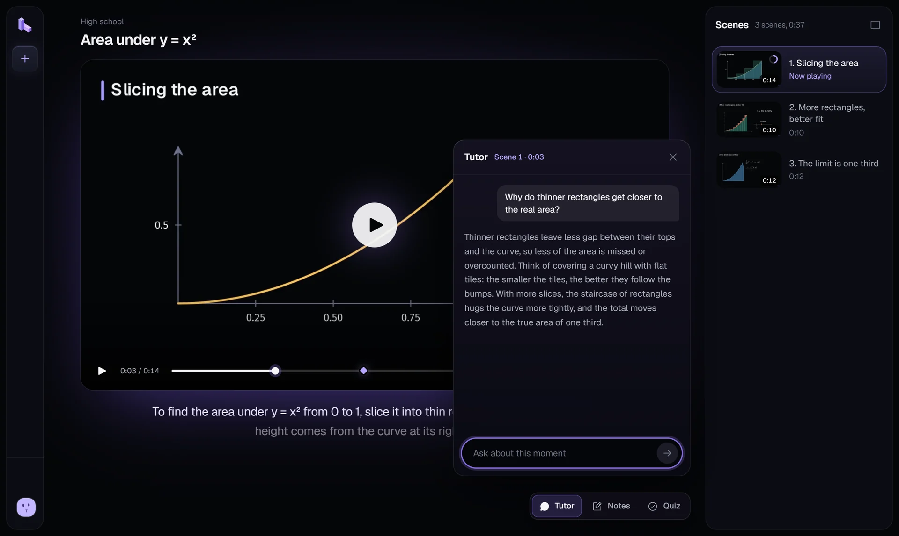
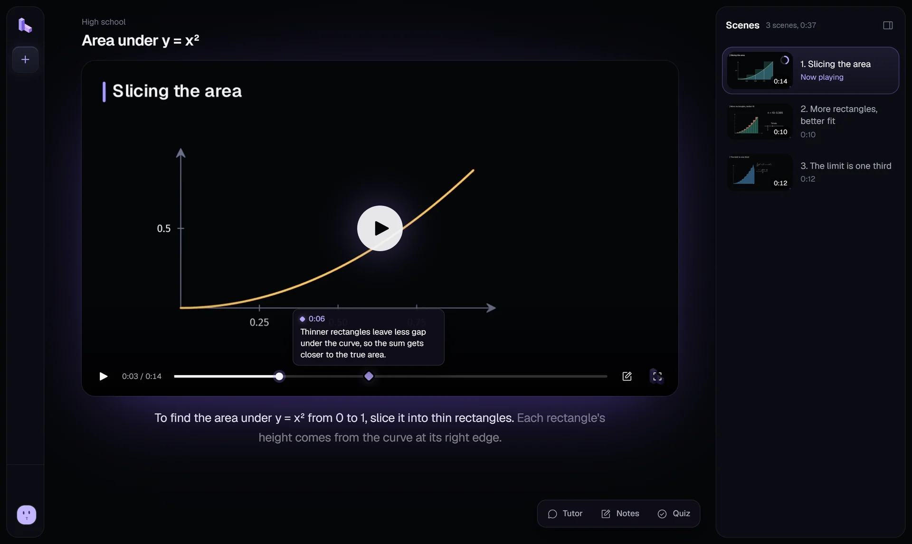
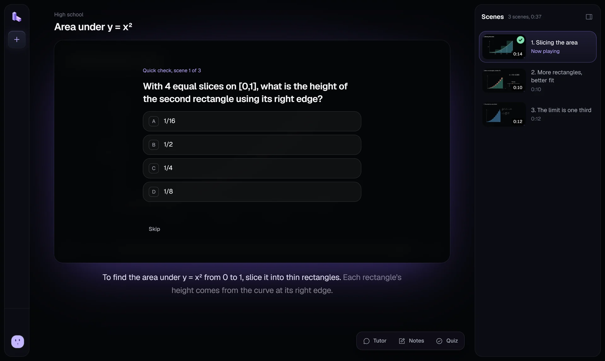
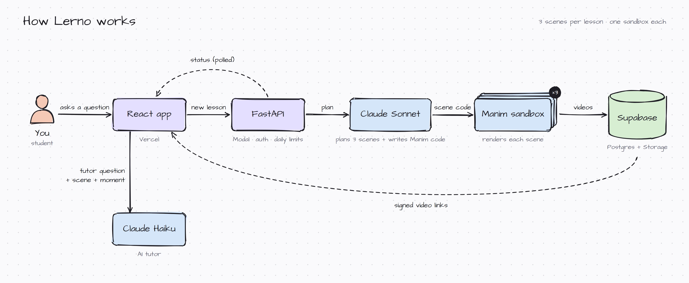

<div align="center">

<picture>
  <source media="(prefers-color-scheme: dark)" srcset=".github/assets/banner-dark.webp">
  <source media="(prefers-color-scheme: light)" srcset=".github/assets/banner-light.webp">
  
</picture>

<br>

[](https://lerno-ai.vercel.app)


**[Live site](https://lerno-ai.vercel.app)** · **[How it works](#how-it-works)** · **[Run locally](#run-locally)**

</div>

<br>

Lerno turns a maths question into a short lesson you watch. Ask *"Why is the area under y = x² from 0 to 2 equal to 8/3?"* and Lerno plans three short scenes, writes the animation code for each one, renders them with [Manim](https://www.manim.community/), and opens a player with narration, a quick check after every scene, an AI tutor that knows where you paused, and notes pinned to the timeline.

<p align="center">
  
</p>

## Features

<table>
  <tr>
    <td width="50%" valign="top">
      
      <h3>Animated lessons</h3>
      Every lesson is three short scenes drawn in Manim, the engine behind 3Blue1Brown's videos. The narration sits under the film like subtitles, and each scene shows a progress ring that turns into a tick when you finish it.
    </td>
    <td width="50%" valign="top">
      
      <h3>A tutor that knows the moment</h3>
      Ask about what is on screen. The tutor gets the scene and the exact time you paused, so its answer is about the picture in front of you.
    </td>
  </tr>
  <tr>
    <td width="50%" valign="top">
      
      <h3>Notes on the timeline</h3>
      Save a thought at the current moment. It becomes a marker on the progress bar: hover to read it, click to open it in your notes.
    </td>
    <td width="50%" valign="top">
      
      <h3>A quick check after every scene</h3>
      A four-choice question at the end of each scene, so you know whether the idea landed before you move on. The Quiz panel keeps your score, plus a short written question for every scene with its answer.
    </td>
  </tr>
</table>

Also: three levels (school, high school, college), keyboard shortcuts (<kbd>Space</kbd>, <kbd>←</kbd> <kbd>→</kbd>, <kbd>T</kbd>, <kbd>N</kbd>, <kbd>Q</kbd>), progress that resumes where you stopped (saved in your browser), and a live "being made" screen while a lesson renders.

## How it works

<picture>
  <source media="(prefers-color-scheme: dark)" srcset=".github/assets/architecture-dark.webp">
  <source media="(prefers-color-scheme: light)" srcset=".github/assets/architecture-light.webp">
  
</picture>

1. **Plan.** Claude Sonnet turns the question and level into a lesson plan: a title and, for each of three scenes, a title, the narration, a description of the animation, a four-choice question, and a short written question with its answer.
2. **Write and render.** The three scenes then run in parallel. For each one, Claude Sonnet writes Manim code in the Lerno theme, and the scene renders in its own Modal sandbox from the official Manim image, with the Lerno fonts and theme added. A check stops any scene whose text leaves the frame. If a render fails, the error goes back to Claude to repair the code, up to two times; a scene that still cannot be animated plays as narration, and the lesson fails only if no scene works.
3. **Store.** Videos go to Supabase Storage; the lesson, scenes and notes live in Postgres, and tutor messages are kept for 24 hours. The player gets short-lived signed links.
4. **Watch.** The React app polls while the lesson is made, then opens the player. The tutor runs on Claude Haiku with the scene and the moment as context.

Daily limits keep costs in check: 3 lessons per person (failed ones are free), a cap on tries, a global daily cap, 20 tutor questions per person every 24 hours, and 100 notes per lesson.

## Tech stack

| Layer | Tools |
| --- | --- |
| Frontend | React 19, React Router 7, Vite, Tailwind CSS 4, Motion, Lenis, Phosphor icons, Geist |
| Backend | FastAPI, Pydantic, Python 3.12, uv |
| AI | Claude Sonnet 5.5 (lesson planner), Claude Haiku 5.5 (tutor), Anthropic Python SDK |
| Rendering | Manim Community 0.19 in Modal sandboxes |
| Data and auth | Supabase Postgres, Storage, and Auth (email and Google) |
| Hosting | Vercel (frontend), Modal (API, jobs, and rendering) |

## Run locally

**You need:** Node.js 20.19+ or 22.12+, Python 3.12+ with [uv](https://docs.astral.sh/uv/), a [Supabase](https://supabase.com) project, a [Modal](https://modal.com) account, and an [Anthropic API key](https://console.anthropic.com).

**1. Database and sign-in.** In the Supabase SQL editor, run [`supabase/schema.sql`](supabase/schema.sql). The files in `supabase/migrations` are only for databases made before those changes. In Authentication, turn on Email (and Google, if you want it), and add `http://localhost:5173/**` to the redirect URLs.

**2. Backend.**

```bash
cd backend
uv sync
cp .env.example .env              # fill in the values below
modal secret create lerno-secrets --from-dotenv .env
uv run modal serve modal_app.py   # prints the API URL
```

| Variable | What it is |
| --- | --- |
| `ANTHROPIC_API_KEY` | Your Anthropic API key |
| `SUPABASE_URL` | The Supabase project URL |
| `SUPABASE_SERVICE_KEY` | The Supabase service key (server only, never in the frontend) |
| `FRONTEND_URL` | Allowed sites, comma-separated, e.g. `http://localhost:5173` |
| `ENVIRONMENT` | `development` or `production` |

**3. Frontend.**

```bash
cd frontend
npm install
cp .env.example .env              # fill in the values below
npm run dev                       # http://localhost:5173
```

| Variable | What it is |
| --- | --- |
| `VITE_SUPABASE_URL` | The Supabase project URL |
| `VITE_SUPABASE_PUBLISHABLE_KEY` | The Supabase publishable (anon) key |
| `VITE_API_URL` | The API URL that `modal serve` printed |

To deploy, run `uv run modal deploy modal_app.py` for the backend, and connect the repository to Vercel with `frontend` as the root folder.

## Project structure

```
backend/
  modal_app.py          Modal app: the API, the lesson job, and the clean-up schedule
  app/
    routes/             lessons, notes, tutor messages, usage
    services/           llm (Claude), prompts, pipeline, renderer (Manim sandbox)
    scene_kit/          the Lerno theme, fonts, and logo for every scene
frontend/
  src/
    pages/              home, sign-in and sign-up, password reset, new lesson, lesson
    components/
      app/              shell, sidebar, account menu, cards
      making/           the "being made" screen
      watch/            player, scenes, tutor, notes, quiz
    hooks/  lib/        data, auth, and the lesson and still stores
supabase/
  schema.sql            tables, row-level security, storage
```

## License

Copyright © 2026 Suryansh Pratap Singh. All rights reserved. The source is public to read; it is not licensed for reuse.
